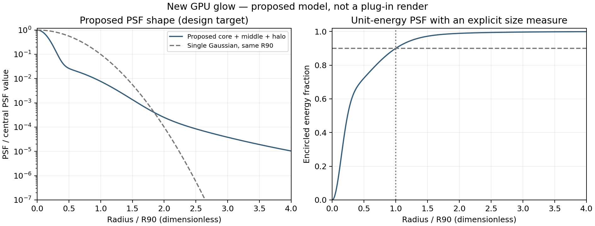

# HaloGlowプラグイン仕様書

版：0.5／作成日・改訂日：2026年10月21日。

位置付け：初版の実装・試作・評価に使う設計仕様。数式、UI、処理契約と合否条件を定める。v0.5では、After Effects SDKの色管理APIとMFRの制約に合わせて色管理の保証範囲を改め、対応プラットフォーム、製品識別子、ローカライズ、異方性ピラミッドの縮小規則を確定した。変更点の一覧は付録Aにある。GPU速度測定と画質の評価試験はまだ行っていない。

## 1. 製品の目的

明るい部分から、芯のある光と広い光の裾を自然に広げる。閾値、抽出の柔らかさ、幅・高さ、減衰、色、原画と発光の不透明度を独立して調整でき、文字、CG、実写に使えるグローとする。

GPUを主経路とし、同じ解像度の大きなぼかし画像を何枚も保持する構成を避ける。発光源の色比、細部、時間安定性を優先する。必要な調整項目を残し、空間処理の共有とGPU内での処理融合によって軽量化する。

画質の目標は「Gaussianを大きくぼかしただけの平坦な光」から離れ、中心部、中間の拡散、遠くまで弱く続くハローを連続した形で表現することである。これは設計目標であり、他方式より美しいことを実証済みという意味ではない。

## 2. 初版の対象

### 2.1 ホストとGPU

初版はWindows 11 x64とmacOS（Apple Silicon・Intelのuniversalバイナリ）のAfter Effects向けエフェクトとする。他ホストへの移植は初版に含めない。

- After EffectsのSmartFXと、ホストが提供するGPUレンダリング経路を使う。
- WindowsではCUDA（NVIDIA）とOpenCL（ホストがOpenCLを選択した場合）、macOSではMetalを対象とする。三系統は同じコア定義、同じ係数表、同じ演算順序の契約を共有する。
- ホストがDirectX経路でレンダーする場合、および上記以外のGPU経路では、同じフィルター構成のCPU実装へ切り替える。ホスト提供のDirectX経路は後続版の候補とする。
- ホストがGPU経路を提供しない場合も、同じフィルター構成のCPU実装へ切り替える。
- 正式対応するホスト版、CUDAランタイム、OpenCL機能水準、Metalの最小OSは、SDKと実機の互換試験で確定し、配布物に明記する。暫定の最小値は第18章に置く。
- Premiere Pro、OFX対応は後続版の候補とする。

独自のOpenGL画面やDirectXコンテキストを、エフェクト処理経路として追加しない。GPU資源はホストが渡すデバイス・キュー・画像だけを使う。[Adobe GPU説明](https://helpx.adobe.com/uk/after-effects/desktop/get-started/technical-requirements/basics-gpu-after-effects.html)、[SDK案内](https://developer.adobe.com/after-effects/)

### 2.2 画像と色

8-bit、16-bit、32-bit floatのホスト画像を受け付け、処理内部はホストから渡された作業RGB、プリマルチプライRGBA、FP32を基準にする。HDR値を1で切らない。

#### 2.2.1 入力表現の基本契約

エフェクトは、ホストから供給された作業RGB値をそのまま入力表現として処理する。空間フィルター、抽出、階調、合成はこの値に対して行う。

- エフェクト自身が、レンダー時にプロジェクトの作業色空間やLinearize Working Spaceの状態を再取得することは保証しない。
- 入力RGBがどの伝達関数で符号化されているかを推測して、内部で自動的にdecodeしない。入力が既に線形化された作業空間である可能性があり、sRGB EOTF等を誤って掛けると二重線形化になるためである。
- 正確な線形光のグローとしての画質保証は、ホストが線形の作業空間値をエフェクトへ供給する構成に限定する。After Effectsでは、線形光の正確なグローが必要な場合、Linearize Working Space、線形のOCIO作業空間等で、ホスト側で線形の作業値となる構成を推奨し、ヘルプに記す。
- 非線形の作業値をそのまま渡した構成も処理は成立するが、線形光としての保証対象外とする。
- 本製品はホストの色管理そのものを再実装する製品ではない。

#### 2.2.2 原色と輝度係数

作業RGBから輝度Yを求める係数`l=(lR,lG,lB)`は、Luminance Space（第3.12節）の手動指定、またはbest-effortのAutoキャッシュから決める。lは、作業RGBの原色と白色点から得たRGB→XYZ変換のY行とする。手動指定は常にAutoより優先する。

lは、Threshold判定（第6章）、Saturation（第8.1節）、発光アルファの補助量（第6.3節・第8.1節）、その他の本仕様で`dot(l,RGB)`を使う全ての箇所に用いる。広色域を常にRec.709の輝度係数だけで扱わない。

#### 2.2.3 原色と伝達関数の分離

初版はLuminance Spaceの選択から伝達関数を暗黙に決めない。例えばDisplay P3の指定は「入力がDisplay P3の非線形伝達関数で符号化されている」ことを意味しない。Display P3原色の線形値である可能性があるためである。

- 原色と輝度係数は、プラグイン側で選択できる。
- 伝達関数と線形化は、ホスト側の責任とする。

将来、明示的なInput Transferメニュー（Auto／Linear／sRGB／Rec.709等）を追加する場合は、Luminance Spaceとは別の軸として扱い、一つのenumに混同しない。初版ではこのメニューを追加せず、線形光の保証条件を限定する方針を優先する。

初版の検証対象の原色は、sRGB／Rec.709、Display P3、ACEScgとする。

GPUとCPUが同じ輝度係数と同じ数値形式変換を使用することを必須とする。

## 3. 操作仕様

本製品は入力の伝達関数を自動判別しない（第2.2節）。linear EXR、Log、独自伝達関数の素材は、ホストの色管理で線形の作業値へ変換してから使う。ICC／OCIO情報を取得できたことだけで、任意のプロジェクトで正しい線形光処理を行うとは宣言しない。

パラメータはUIだけでなくexpression・保存値からの評価時にも検査する。有限の範囲外値は公開範囲へclampし、NaN／Infはその項目の既定値へ置換する。範囲外のpopup値は既定値へ置換する。色はホストが作業空間で返す浮動小数の値（`PF_ColorParamSuite1`）を使い、有限の非負作業RGBとして扱う。負成分は0へ制限し、非有限成分は0とする。内部校正係数は同じ処理で修復せず、無効な表を初期化エラーとする。

### 3.1 基本UI

```text
Glow
  基本
    Intensity              1.00
    Size                   64 px
    Threshold              25 %
    Threshold Softness     50 %
  形状
    Width                  100 %
    Height                 100 %
    Falloff                50
  色・階調
    Gamma                  1.00
    Saturation             100 %
    Colour Strength        0 %
    Colour 1               暖白
    Colour 2               白
    Luminance Space        Auto
  出力
    Glow Opacity           100 %
    Source Opacity         100 %
    □ Glow Only
```

ホスト標準のパラメータUIを用いる。独自パネル、別ウィンドウ、追加の設定画面は初版に設けない。表示名は英語（イギリス綴り）を基準とし、日本語・簡体字中国語・韓国語の表示名を第18.3節に定める。

### 3.2 Intensity

範囲は0〜8、既定値は1。通常域の内部ゲインはその値を使う。PSFで広げた発光成分に掛け、その後にSaturation、Gamma、着色の順で処理する。最終段でフェードするGlow Opacityとは作用位置を分ける。

0では発光成分を0にしてピラミッドを作らず、Source Opacityだけを適用する。グローのみ出力では透明な黒を返す。原画のバイト単位コピーは、Source Opacity=100で原画をそのまま返せる場合に限る。

### 3.3 Size

範囲は0〜512、既定値は64。単位はフル解像度の正方画素で換算したpxとする。プレビューを半解像度にしても、見た目の相対的な広がりは変えない。非正方画素ではピクセルアスペクトを座標変換へ含める。

値Rは、Width=Height=100%における目標PSFの積分エネルギーの90%を含む半径R90に対応させる。幅・高さを変えた場合は、その楕円座標で90%を定義する。離散化の影響が大きい軸では厳密な半径一致を要求せず、0から連続して広がることを優先する。

R=0ではグローを生成せず、Source Opacityだけを適用する。グローのみは透明な黒とする。

有効半径を`Rmax=max(R×Width/100,R×Height/100)`とし、`v=clamp(Rmax,0,1)`、`fR=v²(3-2v)`、`g=Intensity×fR`とする。両軸が0へ近づくと発光量も0へ近づく。片方だけが0の場合は他方の軸に沿う発光とする。

0<Rmax<1 pxはsubpixel fade領域とする。正規化された空間PSF自体の総和は1だが、fRによって発光総量を意図的に減らす。したがって、最終グローの総量保存をこの領域には要求しない。Rmax≥1、中立の色・階調、切取りなしの場合を総量保存の試験条件とする。

### 3.4 ThresholdとThreshold Softness

Thresholdは線形白1に対する百分率で、既定25%、スライダーの標準範囲0〜100%、数値入力の範囲0〜1600%とする。100%は線形値1、400%は4に対応する。表示値に隠れた4乗変換は入れない。

Threshold Softnessは範囲0〜100%、既定50%。Thresholdに対するknee幅を独立して調整する。0ではkneeのない抽出、値を増やすと閾値周辺を滑らかにする。空間的にぼかす設定ではない。

Threshold=0では可視の画像全体を発光源にする。正のRGBの色比を保つため、標準の抽出は一つの輝度から採用率を求める。初版に入力チャンネル選択は追加しない。

### 3.5 グローのみ

既定はoff。offでは原画にグローを加え、onでは発光成分と対応するアルファだけを返す。比較・別レイヤーでの合成に使う。表示モードによってグロー本体のPSFや強度は変えない。

### 3.6 WidthとHeight

範囲はそれぞれ0〜400%、既定100%。Sizeに対する軸ごとの倍率とする。Widthだけを増やすと横長、Heightだけを増やすと縦長になる。互いの値を上書きしない。

片軸0ではその軸をデルタ関数にした一次元の極限として扱う。両軸0では発光を0にする。極端な縦横比でも、細い軸が低解像度化によって勝手に太らないことを要求する。

### 3.7 Falloff

範囲0〜100、既定50。中心・中距離・長い裾の構成比を変える。値を上げるほど弱く広い裾を厚くし、値を下げるほど光源付近へ集中させる。Sizeは90%包囲半径の基準を保つ。

Qualityや反復回数の設定とはしない。第5章の正規化PSFを変更し、GPU側ではピラミッドの係数を更新する。

### 3.8 Gamma

範囲0.1〜3、既定1。Intensityを適用した後の発光輝度へ逆Gammaの指数を掛ける。低い発光輝度ではGamma>1で裾が見えやすく、Gamma<1で締まる。原画へは適用しない。

### 3.9 Saturation

範囲0〜200%、既定100%。発光成分の彩度を輝度基準で変える。100%では元の色、0%では無彩色とする。原画の彩度は変えない。

### 3.10 Colour 1、Colour 2、Colour Strength

Colour 1は弱い発光や裾、Colour 2は強い発光や中心に割り当てる。既定はColour 1がsRGB表記`#FFE4C4`の暖白、Colour 2が白。色はホストのカラーピッカーで選ぶ。保存値はホストの色パラメータそのものとし、評価時に`PF_ColorParamSuite1`で作業空間の浮動小数値を取得する。プラグインは色パラメータへ独自の伝達関数変換を掛けない。線形の作業空間では既定のColour 1は線形の暖白となり、非線形の作業空間ではその作業値のまま使われる（第2.2節）。

Colour Strengthは0〜100%、既定0%。0%では元の発光色、100%では二色の着色を使い、中間は混合する。初期状態で意図しない着色をしない。色を黒にすると発光RGBも減り、その結果に応じて発光アルファも抑える。

### 3.11 Glow OpacityとSource Opacity

範囲はそれぞれ0〜100%、既定100%。Glow Opacityは階調・着色まで終えた発光RGBとアルファを最終段でフェードする。Source Opacityは原画のプリマルチプライRGBとアルファを同じ割合でフェードする。

Source Opacity=0でもGlow Opacityが正なら発光は残る。Glow Opacity=0なら原画だけを返す。グローのみではSource Opacityは出力に影響せず、UIでは無効表示にするが値は保持する。無効表示は`PF_ParamFlag_SUPERVISE`を付けたGlow Onlyの変更と`PF_Cmd_UPDATE_PARAMS_UI`で更新する。

### 3.12 Luminance Space

作業RGBの原色を指定し、輝度係数l（第2.2.2節）を決めるpopup。既定はAuto。選択肢と係数を次とする。係数は各規格の原色と白色点のxy座標（D65=(0.3127,0.3290)、ACEScgはAP1原色とACES白色点(0.32168,0.33767)）からRGB→XYZ行列を求め、そのY行を小数7桁へ丸めた値である。

```text
Auto            キャッシュ済みの作業空間情報（best-effort）
Rec.709 / sRGB  l = (0.2126390, 0.7151687, 0.0721923)
Display P3      l = (0.2289746, 0.6917385, 0.0792869)
ACEScg          l = (0.2722287, 0.6740818, 0.0536895)
```

各係数の総和は丸め誤差の範囲で1とし、実装は総和で再正規化した値を使う。内部表現は将来の追加に備えたenumとし、保存値は1始まりのpopup値とする。項目を追加する場合は末尾へ足し、既存の番号を変えない。

Luminance Spaceは原色だけを決める。伝達関数・線形化は決めない（第2.2.3節）。

#### 3.12.1 Autoの扱い

Autoは、main thread上で取得できた作業空間の情報を使うbest-effortモードである。取得候補は、`AEGP_ColorSettingsSuite6`で利用できる範囲の作業カラープロファイル（ICCの説明文字列・原色タグ）、OCIO作業色空間名、作業色空間IDとする。

- 取得は、ホストがmain threadから送る安全なコマンド（例：`PF_Cmd_UPDATE_PARAMS_UI`、`PF_Cmd_USER_CHANGED_PARAM`）の中でだけ行う。`PF_Cmd_SEQUENCE_SETUP`／`PF_Cmd_SEQUENCE_RESETUP`がmain threadで呼ばれるとは仮定しない。
- render系selector（`PF_Cmd_SMART_PRE_RENDER`、`PF_Cmd_SMART_RENDER`、GPU用のselector等）からAEGPを呼ばない。render threadからキャッシュを更新しない。
- プロジェクトの色設定を変更した後、キャッシュが即座に更新される保証はない。古い（stale）自動判定値が存在し得る。
- 取得した情報から原色を確証できない場合、推測でsRGB等の伝達関数へ変換しない。
- `PF_OutFlag2_I_USE_COLORSPACE_ENUMERATION`を、作業色空間をエフェクトへ渡す仕組みとして使わない。

Autoの内部状態を次の三つに区別する。

```text
verified     このプロセスでmain threadから取得し、原色を既知の表へ一致させた
cached       過去に取得した値。現在の設定と一致する保証はない（potentially stale）
unavailable  一度も取得できていない、または既知の原色へ一致しない
```

unavailableの場合、Autoは互換fallbackとしてRec.709 / sRGBの係数を使う。これは正しい自動判定ではなく、明示的な互換fallbackである。初版ではこの状態を表示する追加UIを必須としないが、診断ログへ記録できる設計とする。

Autoキャッシュは、レンダー結果の正しさを保証する唯一の根拠にしない。ユーザーは手動指定へ切り替えることで、キャッシュの内容に関係なく係数を確定できる。

#### 3.12.2 キャッシュの公開とMFR

キャッシュはプロセス単位の不変スナップショット（係数、状態、世代番号）として保持する。

- main threadで新しいスナップショットを作り、原子的な参照の差替えで公開する。公開済みのスナップショットを書き換えない。
- 各レンダーは開始時に一度だけ参照を取得し、そのレンダーの間は同じスナップショットを使う。古いスナップショットは参照が残る間は解放しない。
- 全レンダーを大域ロックで直列化しない。
- Autoのとき、`PF_Cmd_SMART_PRE_RENDER`で解決済みの係数を`GuidMixInPtr`（`PF_OutFlag2_I_MIX_GUID_DEPENDENCIES`）へ混ぜ、係数の変化をホストのキャッシュキーへ反映する。手動指定のときは混ぜない。
- 取得できない状況でもMFRのレンダー自体は成立する。

## 4. 初版の機能範囲

必須機能は、発光源抽出、縦横独立の正規化PSFによる拡散、Falloff、発光の階調・彩度・二色着色、原画と発光の個別不透明度、線形HDR合成、透明素材用のアルファ生成、GPU処理、CPUフォールバックとする。

色収差、RGB別の幾何スケール、回折の星形、レンズフレア、色相キー、幾何マスク、ノイズ、品質メニュー、プリセット管理UIは初版へ追加しない。局所的な適用にはホストのマスクとエフェクト合成機能を使う。

画像処理に関わる操作は、12数値、2色、Luminance Space、出力スイッチの計16項目とする。項目数を少なく保つことよりも、誤った色の扱いを暗黙に適用しないことを優先する。基本・形状・色と階調・出力へ整理し、PSFの専門的な内部係数は公開しない。全値と内部アルゴリズム版を保存する（第18.2節）。

## 5. 画質モデル

### 5.1 PSFの構成

PSFは、点光源を入力したときに光が広がる形を表す。初期の設計用モデルを、狭い中心、中距離、長い裾の正の混合とする。FalloffをF、f=F/100とする。

```text
Gσ(r) = exp(-r²/(2σ²)) / (2πσ²)
Ma,β(r) = (β-1)/(πa²) × (1+(r/a)²)^(-β)

wc(f) = 0.75 - 0.30f
wm(f) = 0.23 + 0.14f
wh(f) = 0.02 + 0.16f
PF(r) = wc(f) G0.10(r) + wm(f) G0.40(r) + wh(f) M0.80,2.5(r)
```

ここでrは寸法を持たない設計座標である。構成比は全て非負で総和1。F=50では従来の設計図と同じ0.60／0.30／0.10となる。r>4を0とし、残る面積積分が1になるように再正規化したものを`P̂F`とする。

係数と幅は本製品の初期設計値であり、論文から測定値として転記したものではない。画質試作の評価で変更できるが、変更後は全ての画質試験とサイズ校正をやり直す。

2次元で無限に続く厳密な1/r²は積分が対数発散する。初版はそれを正規化PSFとして採用せず、β>1のMoffat成分と有限支持を使う。

### 5.2 サイズの定義

`P̂F`のR90をq90(F)とし、R>0に対して次を目標PSFとする。

```text
q90(50) ≈ 0.7192929521
scale = R/q90(F)
KR,F(r) = P̂F(r/scale)/scale²
```

Falloff=50での連続モデルの支持半径は約5.561016535Rで、他の値では4R/q90(F)となる。離散PSFは画素面積を考慮して積分し、無限に広い格子上で総和1となるように正規化する。実画像の端で切れたエネルギーを、端ごとの再正規化で画像内へ押し戻さない。

Width倍率をwx=Width/100、Height倍率をwy=Height/100とし、両方が正なら次の楕円PSFを使う。広がりを変えても積分エネルギーを保つ。

```text
K(x,y) = KR,F(sqrt((x/wx)²+(y/wy)²)) / (wx wy)
```

片軸0では、変換前のPSFをその軸について積分した周辺分布と、0幅軸のデルタ関数を組み合わせる。単にPSFの中心断面を使ってエネルギーを変えない。両軸0の出力は第3章のバイパスとする。

### 5.3 形状の意図

狭い中心成分で光源付近の密度を保ち、中距離成分で連続した拡散を作り、低い重みのMoffat成分で遠くまで弱く続く裾を加える。中心から遠方までを一つの大きいGaussianだけで表現しない。

これは測定した眼球やレンズを再現する物理シミュレーターではない。PSFの形を参考にした映像演出用の近似である。波長依存や回折の形を初版の画質要件には含めない。



図はFalloff=50、Width=Height=100%の連続モデルの計算結果であり、完成プラグインの描画結果ではない。左は中心値で正規化した形、右は半径内のエネルギーである。

### 5.4 エネルギーの扱い

PSFの正規化は、広がりを変更しただけで発光成分の総量が不安定に変化しないために使う。原画への加算は演出として明るさを増やすため、製品全体をエネルギー保存モデルとは呼ばない。

この総量の基準は、Gamma=1、Saturation=100%、Colour Strength=0の中立設定で評価する。非線形の階調や着色を有効にした出力は、Sizeによる輝度分布の変化を通じて総量も変わり得る。

自動露出、フレーム平均に応じたゲイン補正、時間方向の履歴は使わない。周囲に別の光源が入ったことで、既存の光源の明るさが勝手に変わらないことを優先する。

## 6. 発光源の抽出

### 6.1 入力契約

以下は、ホストから取得した線形のプリマルチプライRGBをC、アルファをα、作業RGBの輝度係数をlとする。

- αは0〜1に制限する。
- α=0の画素のRGBは発光源として使わない。
- 発光源のRGBには`Cplus=max(C,0)`を使う。原画の有限な負RGBは原画側へ保持する。
- 非有限値は、エフェクト有効時の計算前に0へ置換する。発光なし・原画100%をそのまま返すバイトコピー経路だけは例外とする。
- 初版の数値試験範囲は、入力RGBの絶対値2^20以下とする。1を超えるHDR値、特に65504を超える値も検証する。

負RGBを含む色についてまで、発光成分の色比を完全に保存するとは表記しない。色比保持の受入試験は、作業RGB内の非負RGBを対象とする。

入力Adapterでは、色管理変換と数値形式変換を分離する。

- 色管理変換：初版のAdapterは行わない。ホストから作業RGBとして渡された画像は、その値を使う（第2.2節）。エフェクト側で任意のICC／OCIO変換を実施できることを初版の前提にしない。将来Input Transferを追加する場合は、α>0でstraight化→変換→再premultiplyとし、α=0は計算用RGBを0にする。CPU側でstraight化する場合はFP64を使用し、FP32の微小αで中間値をオーバーフローさせない。
- 数値形式変換：8-bitと16-bitの整数値をそれぞれSDKの白基準へ正規化してFP32にする。特にAEの16-bit白を一般画像の65535と決めつけず、PF_MAX_CHAN16を使用する。プリマルチプライの扱い、非有限値の0置換、αの0〜1制限、逆変換と格納時の丸め・範囲制限もAdapterで一元化する。After Effectsはエフェクトのワールドを黒でプリマルチプライした表現で受け渡す（α=0のRGBを残す`preserve_rgb_of_zero_alpha`が別に用意されているのはこのためである）。従ってAdapterはαの掛け直しも割戻しも行わず、本仕様のプリマルチプライ表現のまま読み書きする。この前提はホスト上の半透明素材の確認（§12.3）で検証する。GPU経路ではホストが渡すFP32のBGRA画像を同じ規則で読む。

### 6.2 しきい値の割当て

Thresholdの表示値をTui、Threshold SoftnessをSuiとする。線形白1を基準に、しきい値Tとknee幅kを次とする。

```text
T = Tui/100
k = T × Sui/100
```

既定のTui=25、Sui=50ではT=0.25、k=0.125となる。Sui=0ではk=0となり遷移曲線の丸みがなくなる。T=0は可視画素の採用率を1とする。閾値を正から0へ近づけると、正の輝度の採用率も1へ連続して近づく。

ThresholdとSoftnessを独立してアニメーションできるようにする。Sui=0への極限も数値試験に含め、ゼロ除算を起こさない。

### 6.3 輝度soft knee

アルファを割って非常に大きいstraight RGBを作ることを避け、プリマルチプライ値のまま計算する。

```text
Y = dot(l, Cplus)
t = α T
κ = α k
z = clamp(Y-t+κ, 0, 2κ)
excess = max(Y-t, z*(0.25*(z/κ)))           (κ > 0)
excess = max(Y-t, 0)                (κ = 0)
m_base = clamp(excess/Y, 0, 1)      (α > 0 and Y > 0)
m_base = 0                         (otherwise)
```

T=0ではα>0の画素にm=1、それ以外はm=m_baseを使う。α=0ではm=0とする。この最終的なmから発光源を作る。

```text
E_rgb = m Cplus
E_alpha = min(α, max(dot(l,E_rgb),0))
```

E_alphaは抽出輝度に連動した被覆の補助値とする。黒い画素ではE_rgbとE_alphaがともに0になり、T=0でも光のない部分のアルファだけを増やさない。lはLuminance Spaceから決まる非負の係数（第3.12節）とする。ゼロ除算と非有限値を避ける分岐をGPUとCPUで共通化する。

一つの輝度から求めた最終的なmをRGB全成分へ共通して掛ける。正のRGBの成分比を保ち、飽和した単色光源がチャンネルごとに異なるしきい値で切り替わることを避ける。

FP32ではkneeのz²を先に計算せず、上記のz*(0.25*(z/κ))の順に計算する。κ=0の分岐を先に評価する。階調の(V/Yv)*GΓ(Yv)も括弧内を先に評価する。発光アルファは-expm1(-x)を使用し、GPUにexpm1がなければx<1e-3でx*(1-x/2+x²/6)、それ以外で1-exp(-x)を使い、受入誤差を確認する。subnormal／FTZの差は記録し、微小信号でのビット一致は保証しない。

### 6.4 抽出の位置

発光源の抽出は最初の縮小より前に行う。縮小して平均化したRGBからしきい値を判定する実装は不可とする。

最初の縮小パスと処理を融合する場合も、元の各画素でmとEを求め、その後に補間と縮小フィルターを適用する。双線形補間したRGBへ後から非線形抽出を掛ける処理へ置き換えない。

### 6.5 単色光源と発光基準

初版の発光基準は、Luminance Spaceで決まる作業RGBの輝度に固定する。Rec.709の係数と硬い閾値T=0.25では、α=1の純赤は成分値約1.176、純青は約3.463を超えてから抽出が始まる。白の開始値0.25とは異なる。これは輝度判定の性質であり、HDR値を1でクリップする処理ではない。

max(R,G,B)で採用率を求めても、共通の係数をRGBへ掛ければ色比は保てる。したがって、色比保持のために輝度判定しか選べないわけではない。初版は15項目を維持し、LED・ネオンの単色HDRを評価素材へ追加する。輝度基準で制作上の不足が確認された場合に、独立した発光基準の選択を再検討する。

## 7. GPUフィルター

### 7.1 処理順

```text
ホスト入力
  → 数値形式変換・入力整理（色管理変換は行わない）
  → 発光源抽出を融合した最初の縮小
  → 縮小ピラミッド
  → PSF係数を使った拡大・蓄積
  → 全解像度の中心成分と合成
  → Intensity・Saturation・Gamma・二色着色
  → 原画との合成・アルファ生成
  → ホストの色表現へ戻して出力
```

発光源のRGBとアルファに同じ正の空間フィルターを掛ける。色収差やRGB別の幾何変換は行わない。

### 7.2 縮小パス

最初の画像をD0=Eとし、D0は全解像度の一時画像へ保存せず、入力から計算できるものとする。等方的な設定ではD1以降の縦横を約1/2にし、奇数寸法は切り上げる。

異方的な設定では、有効半径Rx=R×wx、Ry=R×wyから各軸の必要な縮小段数Lx、Lyを校正する。Lmax=max(Lx,Ly)、各軸の遅延をΔx=Lmax−Lx、Δy=Lmax−Lyとし、階層jでの縮小回数を各軸`nx(j)=max(0,j−Δx)`、`ny(j)=max(0,j−Δy)`とする。細い軸は縮小の開始を遅らせ、全階層で縦横の縮小比2^(Lx−Ly)を一定に保つ。

v0.4までの`min(j,Lx)`、`min(j,Ly)`は、j≤min(Lx,Ly)の細かい階層を全て等方にする。その場合、芯と中距離の成分が細い軸方向にも2^j画素まで広がる。非負係数の校正ではこの太りを打ち消せず、第3.6節・第12.1節の「細い軸が太らない」と矛盾するため廃止した。

遅延Δ=log2(R_major/R_minor)が整数でない場合は、⌊Δ⌋と⌊Δ⌋+1の二つの遅延のピラミッドを作り、発光成分を重み1−t、t（t=Δ−⌊Δ⌋）で混合する。tが0または1へ近づくと一方のピラミッドだけに連続して移る。Δが使用段数以上なら細い軸は一度も縮小しない（片軸0と同じ扱い）。混合は端数のある縦横比で計算量を約2倍にし、厳密な楕円ではなく隣接する二つの縦横比の混合となる。この近似の形状誤差は第12.1節の異方性試験で測る。片軸0では、その軸の縮小と拡散を行わない。

縮小の初期カーネルは、入力側の画素単位で次の13位置と重みを使う。

```text
(0,0)                           : 1/8
(±2,±2) の4位置                 : 各1/32
(0,±2),(±2,0) の4位置           : 各1/16
(±1,±1) の4位置                 : 各1/8
```

重みの総和は1。全て非負である。出力画素uに対応する入力の中心を、画素インデックス表記で`2(u+0.5)-0.5`へ固定する。縦方向も同様とする。ROIの原点やタイルの位置に合わせて、この位相を変更しない。

片軸だけを縮小する段は、13位置をその軸へ射影した5位置を使う。係数は位置−2、−1、0、1、2に対して1/8、1/4、1/4、1/4、1/8とする。変更しない軸は画素中心を保つ。拡大も、縮小した軸だけに対応するtentを適用する。

最初のパスでは、必要な元画素の抽出値を共有メモリ／ローカルメモリに保持して再利用する。双線形参照が必要な位置は、抽出済みの隣接値を補間する。全解像度の抽出画像をVRAMへ書き出すことは、初版の標準経路では行わない。

縮小はレイヤー基準の無限整数格子に定義する。各段で画素中心を整数インデックスとし、縮小対象軸の入力参照中心は2u+0.5、非縮小軸はuとする。負の原点を含めfloor除算を使い、タイルのローカル原点に位相を合わせない。原点0の全体画像では奇数寸法をceil(N/2)とする。一般ROIは各段のglobal originと整数半開区間[lo,hi)を保持し、逆参照で得た区間のhi-loを収納寸法とする。Nだけから幅を決めない。収納領域の端は処理領域の収納上の端であり、元レイヤー外の中間ハローを0へ切り捨てる境界ではない。

縮小対象軸の逆写像は、拡大先インデックスxに対して(x-0.5)/2とする。第7.3節のtentのオフセット単位は粗い段の画素とし、双線形補間のfloor／ceil参照までCPU参照へ含める。非縮小軸は恒等写像とする。

### 7.3 拡大と蓄積

拡大は3×3 tentを初期カーネルとする。係数は`[1,2,1]`の外積を16で割ったものとする。双線形サンプリングを使う場合も、CPU実装と同じ座標と参照位置を定義する。

階層jの蓄積を次とする。

```text
Gj = aj Dj + cj Bin5(Dj) + Upsample(Gj+1)
B  = a0 E + Σ bh Hh(E) + Σp wp Upsample(G1,p)
aj >= 0, cj >= 0, bh >= 0
Σ aj + Σ cj + Σ bh = 1
```

Bin5は階層jの格子上の分離可能な二項カーネル[1,4,6,4,1]/16で、その階層までに縮小した軸だけに掛ける。各階層の応答の幅（σ_j≈1.22×2^j px）の間を埋める半オクターブの基底であり、オクターブ刻みの階層だけでは端数のオクターブで包囲エネルギー差が最大0.059となったため追加した。wpは第7.2節の異方性の混合重み（等方・整数Δでは1本で1）。Hhは第7.4節の全解像度局所正FIR基底とする。小半径補正を使わない条件では全てのbhを0とする。Bは発光成分である。RGBとアルファを同じ式で計算する。フィルターはDCゲイン1であり、係数総和により無限の一定画像の値を保つ。画面端では外側を0とするため、この一定画像の条件とは区別する。

拡大先の同じ画素にあるDjだけを読み出して上書きし、同じ画像の近傍を読みながら同時に書かない。段間の依存関係はGPUイベント／同一ストリームの順序で保証する。

### 7.4 PSF係数の校正

初回試作では、CPUで計算した第5章の離散PSFを目標に、非負係数ajと必要なサンプル間隔をオフラインで校正する。係数はビルドに同梱する。フレームごとの最適化、機械学習推論、FFTは使わない。

校正表は有効半径、Falloff、縦横比を対象にし、隣接する区間を連続補間する。幅・高さの比を、等方PSFを拡大しただけの最終UV操作で済ませない。段を増減する位置では、追加段の係数が0から連続して変わるようにする。補間後は係数総和を再正規化する。サンプル数や段数を整数で急に切り替え、グローの明るさが跳ぶ実装は不可とする。

ピラミッドは各軸最大13縮小段を上限案とし、小さい処理範囲では必要な寸法までに制限する。ここでいう寸法は元レイヤーではなく、ハローを含む拡張された処理範囲とする。最終的な上限と校正表は、Size=512、軸倍率400%の形状試験と負荷試験を通して確定する。目標PSFに適合しない場合は、内部のサンプル間隔と固定カーネルを修正する。

校正の目的関数はE_profile+E_EEF+E_2Dとし、三項の重みは1:10:1とする。初期案の1:1:1では包囲エネルギー差が0.03を超える条件が残ったため、E_EEFの重みを上げた。係数ベクトル(a,c,b)へa_j≥0、c_j≥0、b_h≥0、総和1を制約する。実画像のE_imageは校正へ使わず、独立したvalidationに使う。包囲エネルギーは楕円座標で評価し、片軸0は周辺分布の両側積分を使う。

E_profileは固定半径標本での周方向平均プロファイルの平均二乗差を、対象の目標ピークの二乗で割る。E_EEFは0〜1の包囲エネルギー曲線の平均二乗差とする。E_2Dは入力インパルスの各位相pに対し、Σpixels(Kapprox,p−Ktarget,p)²/Σpixels(Ktarget,p²)を計算し、固定位相集合で平均する。基準PSFは正規化されて非ゼロなので分母は正である。異なるサイズの画素数によってこの項の重みを意図せず変えない。位相ごとに別の係数を最適化するのではなく、全位相に共通する一組の係数を求める。

受入試験は目的関数の値とは独立して全項目を満たす必要がある。半径標本には線形格子と裾を評価する対数格子を併用し、位相集合と重みを校正成果物へ保存する。固定サンプル間隔の基底では、和制約付きNNLS／二次計画を用いる。サンプル間隔まで変える場合は外側の探索と分離し、単一のNNLS問題とは呼ばない。

連続の目標PSFを無限格子上で畳み込むモデルはLSIだが、間引きを含む実ピラミッドは一般に線形だが周期的に空間変動する多相系であり、1 pxの平行移動には不変でない。抽出済みEに対する空間段だけの話であり、Threshold・Gammaを含む全処理は線形ですらない。従って近似段を単一のKでB=E*Kと表し、実画像のスペクトルだけで校正の偏りを説明し切ることはしない。多相のインパルスと移動信号を直接試験する。実画像を校正から分ける方針自体は、過適合の回避と評価の説明可能性のため採用する。

v0.3の実際の校正スクリプトでE_imageと呼んでいた項は、既に一つの位相のインパルス画像の2D誤差だった。提供写真3枚で係数を学習したわけではない。既存係数はこの由来を残し、v0.4の多相校正が完了した表とは扱わない。

校正表の圧縮候補はsx=log2(Rwx/q90)、sy=log2(Rwy/q90)の小数部、整数部の差、Falloffであり、共通の整数段数は係数列のシフトへ分離する。ただし固定画素格子、最初と最後の段、奇数寸法では厳密な自己相似性はない。絶対サイズを省いた表で全試験に通ると確認するまでは、完全な縮約を前提にしない。0幅軸はlogへ渡さず専用の一次元表を使い、小半径は専用補正を持つ。octave境界はシフト後の同じ物理スケールの係数を補間し、係数の連続性だけでなく出力形状も確認する。

小半径補正：固定13タップ・ピラミッドだけではR=4の試作で包囲エネルギーの最大差0.25951となり、許容0.03を満たさなかった。そのためa0Eだけで狭い中心を再現する構成を確定仕様にしない。追加するHhの初期候補は、軸ごとに分離可能な正FIRとする。長軸について画素面積で積分したσ=0.5／0.75／1.0／1.5 pxのGaussianを±6 pxで打ち切り、総和1へ正規化する。短軸のσは長軸のσに短軸／長軸の半径比を掛けた値とし、0でデルタとなる。二軸の組合せHh=hx⊗hyにより、片軸が1 px未満の極端な異方性でも細い軸を太らせず、片軸0の一次元極限へ連続させる。等方のGaussianだけを基底とすることは不可とする。混合後の局所カーネルは最大13×13である。全解像度画像を追加保存せず、元画素ごとの抽出を含む最終パスの共有メモリで評価する案を検証する。

等方R=4の一位相では、この追加基底により包囲エネルギー最大差0.00921へ減った。ただし全半径、全位相、Falloff、片軸0、異方性に対する校正・速度は未検証であり、局所補正の適用区間も未確定とする。連続補間、必要サンプル範囲、転送量を含めて第12章を通した後に表を固定する。形状不一致を受入条件の緩和で隠さない。

局所FIRのGPU契約：16×16の出力blockを初期案とし、半径6の入力tile+halo、28×28画素をshared/local memoryへ協調ロードする。block内の各入力画素について色変換・発光源抽出を一度だけ評価し、E_rgbとE_alphaのRGBA FP32を保存する。隣接blockのhaloは重複してよいが、出力画素ごとに169回の入力取得と非線形抽出を繰り返す実装は標準経路にしない。

全Hhと中心成分は同じ抽出済みtileを共有する。係数がblock内で一定ならW=a0δ+ΣbhHhを先に合成し、局所のRGBA畳込みを一回で計算する。別々のHhを評価する場合も入力と抽出を共有する。169回のshared/local参照や積和自体がなくなるわけではない。初期案の抽出回数は256×169=43,264から28×28=784へ減るが、約55.18倍という値は抽出回数の比であり、レンダー速度の改善率ではない。

抽出tileの論理容量は784×16=12,544 bytes（12.25 KiB）。行padding、係数、追加の一時値、register圧、occupancyは別途計上する。初版のAdapterは色管理変換を行わないので、数値形式変換だけをこのロードへ融合する。CUDA、OpenCL、Metalで同じロード・同期・演算順序の契約を使う。

端blockでもbarrier前に有効出力外のthreadをreturnさせない。全参加threadが協調ロードとbarrierを終え、その後に出力範囲を判定する。レイヤー外は抽出値0、タイル境界は実際の入力haloを読む。上記の局所haloはピラミッド全体のROIとは別である。block寸法・行padding・共有領域方式はdevice制限と実測で確定し、小半径補正込みで第11章の目標を再測定する。

### 7.5 作業メモリ

初版はFP32のRGBA一時画像を使う。FP16は最適化候補にとどめる。FP32で演算しても、FP16の一時画像へ保存する時点で65504を超える値が失われるためである。

全解像度の入力・出力を除く、一系統の半解像度以下のピラミッドの理論的な画像容量は、約`16WH/3`バイトである。3840×2160では約42.19 MiBになる。実際にはアラインメント、段の端数、フィルターの余白、メタデータが加わる。

4Kの標準試験条件では一時GPUメモリ64 MiB以下を目標とする。片軸だけを縮小する極端な異方性では画像容量が約16WHバイトへ近づき、4Kで約126.56 MiBとなるため、その条件の一時メモリ目標は160 MiB以下とする。入力・出力、ホストのキャッシュ、拡張されたレンダー範囲は別に計上する。全解像度の追加RGBA画像を持たないことを基本とする。

画像メモリはデバイス・寸法・形式・アルゴリズム版をキーにプールする。パラメータ変更のたびに確保し直さない。並列フレームは別の作業領域を持ち、同じバッファを同時に上書きしない。

MFRでは一フレームの容量と同時実行フレーム数を分けて管理する。同一物理GPUの全インスタンス・contextを集計する管理器に総予算B_deviceを設け、使用中、GPU完了待ち、再利用待ちの全確保量を合算する。B_deviceの配布時の値・決定方法は実機試験で確定する未決事項であり、上記64／160 MiBは総予算ではない。

確保前に全段、拡張ROI、pitch、係数、ステージングを含む必要量を64-bitのchecked演算で求め、予約を原子的に取得する。予算超過ならアイドル領域を回収し、SDKで許可されたCPUへの再試行または資源不足エラーを返す。黙って半径や精度を下げない。ホストのロックを保持して他フレームの完了を待たない。プールはサイズクラスで再利用し、キャンセル後もGPU完了フェンス前には再貸与しない。全デバイスを直列化する大域ロックは使わない。

MFR=1／2／4／8相当の同時レンダーとキャンセルでピーク確保量を計測する。入力・出力およびホスト自身の確保量は別に記録し、予算が確保できない状況も強制して、リーク、デッドロック、フレーム間の混線がないことを確認する。

### 7.6 軽量化とパラメータの関係

ThresholdとSoftnessは最初の抽出へ、Width・Height・Falloffは共通のピラミッドの軸と係数へ反映する。Gamma・Saturation・Colour Strength・二色着色・両Opacityは最終パスへ融合し、それぞれのために全解像度の画像を増やさない。

ホストのキャッシュが許す場合は、発光源、空間フィルター、階調と着色、出力のキーを分ける。Opacityや色だけの変更で、変更されていない空間処理の再実行を避ける。キャッシュが使えない場合も出力は同じにする。

必要入力矩形は出力ROIから実際のタップ参照グラフを逆向きにたどって求める。各段で座標変換、タップ幅、補間のfloor／ceilを適用し、全経路の和集合を取る。目標PSFの半幅ceil(4Rwx/q90)、ceil(4Rwy/q90)だけを一律マージンにして済ませない。校正後の実フィルター支持と比較し、全必要参照を含める。

最大Size=512、軸400%、Falloff=50では目標だけでも片側約11,389 pxに達する。出力拡張範囲と入力要求範囲を区別し、SmartFXで表現可能な矩形、ホストの寸法制限、整数オーバーフロー、実容量をpre-render時に確認する。未対応の範囲は明示的なエラーとし、キャッシュ用の結果矩形を小さく偽らない。

## 8. 透明素材と最終合成

### 8.1 原画への加算

空間フィルター後のRGBをB_rgb、補助アルファ成分をB_alphaとする。gはIntensityと有効半径から求めたゲインである。先に発光の階調と色を決め、その後にOpacityを適用する。

```text
U = g B_rgb
s = Saturation/100
V = max(s U + (1-s) dot(l,U) (1,1,1), 0)
Yv = dot(l,V)

GΓ(Y) = Y^(1/Gamma)                 (0 <= Y <= 1)
GΓ(Y) = 1+(Y-1)/Gamma               (Y > 1)
L0 = (V/Yv) × GΓ(Yv)                  (Yv > 0)
L0 = (0,0,0)                       (Yv = 0)

Y0 = dot(l,L0)
u = clamp(Y0,0,1)
Tint = (1-u) Colour1 + u Colour2
L_tint = Y0 Tint
c = ColourStrength/100
L_rgb = (1-c) L0 + c L_tint
```

Gammaの1を超える領域は、値と傾きが連続な線形拡張とする。HDRへ高いべき乗をそのまま適用してオーバーフローすることを避け、1でクリップしない。Tintを輝度で割らない。白は着色前の輝度を保ち、暗い色は減光し、黒へ近づけるとRGBも連続して0へ近づく。着色による減光は意図した操作であり、PSFのエネルギー保存とは区別する。

```text
x_alpha = max(min(g B_alpha, dot(l,L_rgb)),0)
A_light = -expm1(-x_alpha)
q = GlowOpacity/100
p = SourceOpacity/100
G_rgb = q L_rgb
A_glow = q A_light

C_source = p C_input
α_source = p α_input
C_out = C_source + G_rgb
A_out = α_source + (1-α_source) A_glow
```

RGBは線形光で加算する。B_alphaは被覆と抽出輝度から作る補助量であり、光の物理的な不透明度ではない。着色によってRGBを黒にした場合はA_lightも0になり、光なしのアルファを作らない。OpacityではプリマルチプライRGBと対応するアルファを共にフェードする。

IntensityはGammaと色の割当てより前に作用し、Glow Opacityはその後に作用する。Gamma=1、Saturation=100、Colour Strength=0などの中立設定では、RGB上で同じ倍率になる組合せもあるが、アルファの非線形応答と色・階調調整を含めて同じ設定とは扱わない。

Source Opacity=100の不透明な素材ではA_out=1となる。Source Opacityを下げると原画のアルファも下がる。透明な文字や図形では、元のアルファ外にも発光を表すアルファを生成する。元アルファをそのまま使って、外側の発光を切り捨てる処理にはしない。

Gamma接続の検証：p=1/GammaとするとY=1で左右の値は1、一次微分はpで一致する。二次微分は左p(p-1)、右0で、一般にはC2ではない。これだけを根拠にちらつきが発生すると断定しない。Y=1±1e-3の数値ランプと、HDR点光源の時間ランプをGamma=0.1／1／3で検証し、CPU／GPU差と曲線自体の変化を分けて記録する。目視問題が再現された場合だけ接続帯の平滑化を検討し、式と基準画像を更新する。

発光アルファは被覆の補助量であり、RGBから物理的に一意に決まるものではない。minの二つの引数が等しい箇所は一般に微分不連続だが、値は連続する。現行式は維持し、Gamma、彩度、暗色への着色で補助アルファとのスケールが変わる場合を重点評価する。黒・白・有彩色背景、α=1e-4／0.01／0.5、HDR16／65504を組み合わせ、グローのみと通常合成の双方で縁の切れ・濃い縁・明るさの不自然な跳びを確認する。通常のRGBA-overで任意の背景に対する純加算を完全に再現する保証はない。

### 8.2 グローのみ

グローのみでは`C_out=G_rgb`、`A_out=A_glow`とする。Glow Opacityは適用し、原画とSource Opacityは使わない。ゼロの発光成分は透明な黒で出力する。

このRGBAを通常のover合成で使った結果と、背景へ光だけをAdd合成した結果は一般に同じではない。背景に依存しない発光加算が必要な場合は、ホストのAdd系合成で使う。通常のRGBA-overと純粋な加算を同時に満たす、と説明しない。

### 8.3 出力範囲

発光が必要な範囲まで、ホストが認めるエフェクト出力範囲を拡張する。コンポジションのレンダー対象外へ無制限の画像を確保しない。透明文字の元の小さい境界だけでグローを切り取らない。

元の発光源Eは、真の入力境界の外側を透明な黒とする。各中間段は拡張した処理範囲を持ち、元の境界外へ広がった非ゼロの拡散値も保持する。元レイヤーの境界やレンダータイルの端で、中間の光を0へ切り捨てない。

必要な拡張範囲の外を参照する場合も透明な黒とし、クランプ、ミラー、繰り返しによる光の反射はしない。最終画像の端で失われる光を、端だけ明るくする補正で戻さない。

## 9. ROI、プレビュー、時間安定性

### 9.1 ROIとタイル

入力要求の余白は、実際に使用する縮小・拡大・補間の全参照範囲を軸別に逆算して決める。Falloff=50の等方的な目標PSFの支持半径約5.5611Rだけを、実装の参照範囲と同一視しない。

各階層に必要な余白を持たせ、レンダー対象のタイル端と真の画像端を区別する。ピラミッドの座標はレイヤーの共通原点に固定する。ROIだけを原点にして縮小し直す実装は不可とする。

全フレーム出力と、分割タイルを結合した出力が許容誤差内で一致することを必須とする。必要な入力が得られない場合は、正しい全域要求へ切り替える。境界の欠けを許容して速度を優先しない。

### 9.2 解像度と時間

SizeとWidth・Heightは、ホストのダウンサンプル倍率とピクセルアスペクトから処理解像度へ変換する。品質を別メニューで選ばせず、同じ定義のPSFを追う。

時間方向の履歴、フレーム番号依存の乱数、自動の輝度正規化を使わない。同じ入力、パラメータ、色設定、処理範囲では、フレーム番号や処理順を変えても同じ結果を返す。

点光源の移動では、縮小前の抽出、正規化された縮小カーネル、固定位相、係数の連続補間により、消失・ちらつき・段切替えの跳びを抑える。

## 10. 実装構成

### 10.1 モジュール

- Host Adapter：UI、パラメータ保存、SmartFX、画像取得、色情報、出力範囲、キャンセルを担当する。
- Glow Core：抽出、PSF係数、座標、合成の共通定義を持つ。
- CUDA Backend／OpenCL Backend／Metal Backend：ホストのGPUデバイス・キュー・画像を使って同じ処理を実行する。
- CPU Backend：同じピラミッドと数式を使い、GPUが使えない環境の出力を担う。
- Test Reference：高精度の直接PSFと数値基準を作る。製品の通常レンダーには使わない。

既存の実行バイナリ、共通ランタイム、ライセンス処理、シェーダー文字列へ依存しない。固定係数と実装コードは新規に作成する。

### 10.2 GPUとの連携

ホストから与えられたコンテキストと同期方式を使う。フレームごとのCPUへの画像読み戻しを標準経路に入れない。パラメータ・係数の小さい転送と画像転送は分ける。

カーネルをフレームごとにコンパイルしない。デバイス設定時に準備し、初回準備時間と定常時間を別に測る。GPU専用とCPU専用で、違う見た目になるフォールバックを作らない。

### 10.3 多重フレームと失敗時の動作

フレーム単位の作業領域と色パラメータを分離する。

sequence dataへ保存してよいものは、インスタンスの永続設定と互換用の版情報に限る。輝度係数、Autoキャッシュの状態、係数表の選択、PSF係数は、レンダー開始時に作るimmutable snapshotとして各レンダーが所有する。色空間キャッシュは第3.12.2節の規則で公開し、レンダー中に可変オブジェクトとして書き換えない。staleなキャッシュでもデータ競合やuse-after-freeを起こさない。sequence dataをレンダー中に書き換えない。デバイスごとにプール容量の上限を持ち、同時実行数と一時メモリの積でVRAMを使い切らない。

メモリ不足やデバイス異常で、完成していないGPU画像を出力へ確定しない。ホストが認める場合はフレーム単位でCPUへ再実行し、認めない場合はホストへレンダーエラーを返す。品質係数を無断で下げない。

アルゴリズム版をキャッシュキーと保存データに含める。係数更新によって既存プロジェクトの外観を無条件に変更しない。

## 11. 性能目標

この章の数値は未測定の開発目標であり、配布時の実績値とは分ける。

### 11.1 標準試験

標準GPUの候補はGeForce RTX 3060 12GBとする。実測時にドライバー、ホスト、SDK、GPUクロック条件、CPU、RAMを固定して記録する。別途AMDとIntelの対応GPUで互換性と数値整合を確認する。

入力はRGBA32F、1920×1080と3840×2160、Size=64および256、Width=Height=100%、Falloff=50、Threshold=25%、Softness=50%、Compositeとする。その他は既定値を使う。入力と出力はGPU上にあり、ディスクIO、ホストの画面更新、初回コンパイルを定常カーネル時間に含めない。CPUからの転送を含むホスト全体の時間は別に測る。

### 11.2 合格目標

- 1080p：GPU処理の中央値2 ms以下。
- 4K：中央値6 ms以下、p95が10 ms以下。
- 4Kの標準条件：エフェクト所有の一時GPUメモリ64 MiB以下。極端な異方性は160 MiB以下。ホスト所有の入出力を除く。
- 4KでR=64から256へ変更した際、定常GPU時間の増加が1.5倍以下。
- Intensity=0、Glow Opacity=0、Size=0、または両軸倍率0：一時ピラミッド確保と空間GPUフィルター実行は0回。必要ならSource Opacityだけを処理する。

Width=0・Height=400%、およびWidth=400%・Height=1%を別の負荷試験として計測する。等方的な条件の6 ms目標を無条件に転用せず、軸別のサンプル数、ピークメモリ、時間を併記する。色・階調・Opacityは追加の全解像度パスを発生させないことを確認する。

30フレームの準備後、異なる入力300フレームで測る。キャッシュ済みフレームの再表示時間をレンダー時間として使わない。GPUイベント時間、ホスト全体の時間、ピークメモリを同時に残す。

## 12. 画質と数値の受入試験

### 12.1 PSF形状

単位エネルギーの点を十分に広い画像の中央へ置く。Intensity=1、Gamma=1、Saturation=100%、Colour Strength=0、Glow Opacity=100%で発光成分を測る。Size=4、16、64、256、Falloff=0・50・100を直接計算した離散PSFと比較する。

- 切取りがない条件の発光成分の総量誤差：0.5%以下。
- R90の誤差：目標Rの5%以下。
- 包囲エネルギー曲線の最大絶対差：0.03以下。
- 全画素で負のPSF係数を持たず、黒地に負のリングを作らない。
- 周方向に平均したプロファイルで、不自然な二重の山や段状の輪を作らない。

この条件に通らない間は、提案したPSFを実装できたとは扱わない。中心値だけを合わせて合格にしない。

Width／Heightを100／100、400／25、25／400、0／100にして、楕円座標または一次元周辺分布で同じ形状基準を評価する。細い軸の広がりが意図せず増えていないこと、正の倍率を0へ近づけた出力が一次元の極限へ連続することも確認する。

### 12.1a 角度方向と多相の形状

等方・両軸が正の異方性では、楕円座標へ変換して角度方向も直接評価する。半径ρ、角度θに対しx=wxρcosθ、y=wyρsinθでKを参照し、正規化角度モーメントc_m(ρ)=meanθ[K exp(−imθ)]/meanθ[K]、A_m=abs(c_m)、CVθ=stdθ(K)/meanθ(K)を記録する。まずm=4を必須とし、m=2と8も診断に使う。片軸0へこの2D定義を適用せず、一次元周辺分布で左右差・形状を評価する。

連続等方モデルのA4は0だが、画素面積積分と補間を経た離散目標PSFのA4とCVは必ずしも0ではない。目標と候補を同じ画素積分・位相・補間で参照し、A4、CVに加えてΔA4=abs(c4,approx−c4,target)を測る。振幅の差abs(A4,approx−A4,target)だけでは向きの異なる4回対称成分を見落とすため、複素モーメントの差を使う。

初期の診断域は、楕円半径ρ≥1 pxかつ目標の角度平均が目標ピークの1e-4以上となる半径とする。細い軸で離散化が支配的な条件は別集計する。低信号領域を0割して小さい異方性スコアとして報告しない。最大値、半径曲線、目標の環状エネルギーで重み付けした値を保存する。診断域が包囲する質量も記録し、中心や裾を除いたことで不一致を隠さない。

R=4／16／64／256、Falloff=0／50／100、規定の縦横比と位相について、axis／diagonalの断面、2D残差とPSF画像を確認する。axisとdiagonalに肉眼で識別できる十字・菱形・4回対称成分を生じないことを要求し、表示の正規化とlinear／log表示を固定する。数値の最終合格閾値はCPU referenceの校正・目視評価から事前に固定し、その前は数値を測れただけで合格にしない。

総量・重心だけでなく、整数移動後に位置を戻したPSF同士の相対L2差も位相差として記録する。この差は目標への誤差とは別に集計し、全位相共通の校正と時間安定性の判断へ使う。

### 12.2 色とHDR

白、赤、緑、青、RGB比が異なる点光源を使用する。中立の彩度・Gamma・着色設定における非負RGBのグローについて、信号が十分大きい画素での正規化RGB比の最大絶対誤差を0.01以下とする。

Colour Strength=0のときのSaturation=0で無彩色、Colour Strength=0で選択色の影響なし、二色とも黒かつColour Strength=100でRGBと発光アルファが0となることを確認する。Gammaの1の前後とHDR側の接続、色の割当て、IntensityとGlow Opacityの作用位置も数式に照合する。

線形値0、0.01、0.18、1、16、65504、2^20の入力を確認する。正規化PSFと既知のゲインに対応したHDR値を保持し、1やFP16上限での意図しない飽和を起こさない。適用範囲の有限入力からNaN・Infを生成しない。

### 12.3 透明素材

黒や任意の隠れRGBを持つ完全透明画素、アンチエイリアス付き文字、半透明の単色図形を使う。

- α=0の隠れRGBが発光源にならない。
- 黒い素材は、Threshold=0でもグローのRGB・アルファを生成しない。半透明の黒い原画のアルファを光なしで増やさない。
- 文字の外側へRGBとグローアルファが広がる。
- Source Opacity=100の完全不透明の入力では出力alphaが1のまま。
- 透明素材を黒・白・有彩色背景へ重ね、暗い縁やRGBの異常増幅が出ない。
- Compositeとグローのみが、第8章の合成契約に一致する。
- Glow Opacity=0で原画だけ、Source Opacity=0で発光だけ、両方0で透明な黒になる。Intensity=0でSource Opacityを変えた場合も原画のフェードは有効である。

### 12.4 時間とパラメータ

点光源を1フレームあたり1/8 pxずつ移動する。画面端に接触しない条件で、発光成分の総量の最大値と最小値の差を平均値の2%以下とする。画面端へ移動した結果の切取りは別の試験にする。

Size、Width、Height、Falloffを細かく変え、段境界で輝度と形状が跳ばないことを確認する。Thresholdは0付近とHDR域、Softnessは0付近とknee境界を試験する。同一フレームの順序変更と並列実行で、時間履歴による差を生じないことを確認する。

### 12.5 CPU／GPU、ROI

同じ校正表・座標・フィルターを使うCPU FP32参照出力との成分差を`1e-4 + 1e-3×abs(reference)`以下とする。小さい信号では絶対誤差、大きいHDR値では相対誤差を評価する。CUDA、OpenCL、Metal、最適化したCPU実装に同じテストを適用する。

直接PSFの高精度参照は、第12.1節の形状・R90・包囲エネルギー試験に使う。ピラミッドによる近似差へ、上のCPU／GPU演算差の許容値をそのまま適用しない。

全域出力とタイル結合出力も同じ許容誤差内にする。奇数寸法、1ピクセル幅、非正方画素、半解像度プレビュー、出力範囲拡張、ホストキャンセルを含める。発光が0かつSource Opacity=100のCompositeは、許容誤差ではなく入力のバイト一致で確認する。Source Opacityが100未満の場合は、指定したフェードとの数値一致で評価する。

追加の実装受入条件：

- CUDA／OpenCL／Metal／CPUの線形ランプの座標往復誤差を1e-4 px未満とする。これはFP32のULPがこの値未満になる座標域で、幾何写像を検証する条件である。大座標は整数原点と局所座標へ分離し、出力画像の一致も別途評価する。
- 点光源の重心を二倍格子の全位相と1/8 px移動で測り、入力位置に対するずれ0.05 px以下を暫定基準とする。定数保持と点光源の総量保存は異なる性質なので両方を測る。
- セル幅1 pxと2 pxのcheckerboard、縦縞、横縞、45度縞を移動し、位相依存の形状変化、aliasing、縞状残差を確認する。目視合否は表示変換を固定し、差分画像と位相ごとの数値を保存する。
- 全体描画と異なる大きさ・順序のタイル描画を比較する。奇数寸法、負のROI原点、1×N／N×1、非正方画素、半解像度を含め、第12.5節の誤差内で一致させる。
- 色を白から黒へ連続に変え、Colour Strength=100でRGBと発光アルファが連続して0へ近づくことを確認する。近黒を白と同じ明るさへ正規化してはならない。

CPU／GPUハーネスはホスト統合より先に作る。初期の基準経路ではunsafe fast-mathを無効にし、FMAの使用、演算順序、denormal／FTZ、pow／exp、補間方法を記録する。FP32の同名型でもビット一致は要求せず、最大絶対・相対誤差、超過画素数、最悪入力を保存する。最適化は基準経路と比較し、許容誤差を超える場合に理由なく閾値を緩めない。

校正表はビルド時に確定したimmutableデータとし、レンダー中に更新しない。パラメータから得る係数はレンダー単位のimmutable snapshotとする。遅延初期化は一度だけ安全に公開し、デバイス資源はdevice/context単位に所有する。画像バッファを大域変数やsequence dataに置いて複数レンダーから共有しない。ホストAPIのスレッド利用制限はSDKで個別に確認する。

固定信号のvalidationに、正弦波0.25／0.45／0.5 cycles/pxと対数周波数sweepを加える。ここで0.5 cycles/pxは各軸方向のNyquist境界であり、空間周期は2 pxである。Nyquistの正弦波は位相で全サンプルが0になることもあるため、cosineを含む位相集合を指定する。斜めの信号は各軸の周波数がNyquist範囲内になるよう生成し、rasterから定義できない半画素周期を入力信号として要求しない。

### 12.5a 色管理とMFR

- Luminance SpaceをRec.709 / sRGB、Display P3、ACEScgへ切り替え、既知のRGBに対するYが第3.12節の係数と一致する。
- 手動のLuminance Spaceでは、Autoキャッシュの内容（verified／cached／unavailable、どの原色か）に関係なく同一の結果になる。
- Autoキャッシュが存在しない状態でも、crash、NaN、未初期化値を生じない。このときRec.709 / sRGBの互換fallbackとなることを確認する。
- Autoキャッシュがstaleな状況を人工的に作り、手動指定へ切り替えると正しい係数へ戻る。
- MFRで複数フレームを並列レンダーしながらキャッシュを更新しても、race、deadlock、use-after-free、フレーム間の係数の混線を生じない。スナップショットの参照はレンダー開始時に一度だけ取得されることを確認する。
- ホストが線形の作業値を供給する条件で、PSF畳込み、Threshold、Saturation等が線形値で計算される。
- 非線形の作業値をそのまま渡した場合、内部でsRGB等のdecodeが発生しない（入力と同じ値を抽出前の入力として使う）ことを確認し、線形光の保証対象外であることを試験記録とヘルプに明記する。
- Rec.709、Display P3、ACEScgで同じXYZのYに対応する色を入力し、Threshold挙動が一致する。原色ごとの輝度係数が使われていることを確認する。
- render系selectorでAEGPを呼んでいないことを、コードの監査とデバッグビルドの検査で確認する。

### 12.6 見た目の比較

文字、白い点光源、赤いネオン、逆光の輪郭、夜景、金属の反射、HDRのCGを固定した比較セットとする。R90と発光量を合わせ、単一Gaussian方式、初回試作、調整後の試作を表示名を隠して比較する。

芯の保たれ方、裾の滑らかさ、色、細部、動きのちらつきを別に評価する。単に明るい方を選んだ結果を画質改善としない。客観試験に加え、固定した比較セットの80%以上で調整後の試作を選好されることを初期目標とし、評価人数・順序・選好理由を記録する。これは知覚的な優位性を保証する研究結果ではない。

## 13. 研究から採るもの

### 13.1 中心と散乱の分離

2025年の眼のPSF研究は、狭い中心に関わる回折・収差と、広角の散乱を区別する。本仕様は、芯と広い裾を別成分として設計・評価する考え方を参考にする。論文の学習モデルや角度尺度を、映像のpxへ直接移植しない。[Ntatsisほか、2025](https://doi.org/10.1364/BOE.559749)

### 13.2 PSFを使うグレア研究

2026年のグレア抑制研究は、PSFを含む知覚評価と最適化を扱う。夜間ステレオ研究も、光学PSFに基づく合成を使ってグレアへの頑健性を高める。どちらも、本プラグインの美しさや速度を直接立証する論文ではない。PSFを明示し、点光源と知覚的な結果を検証する設計に活かす。[Beresna・Fiume、EGSR 2026](https://www.linasberesna.com/views/egsr2026.html)、[ICIP 2026のステレオ研究](https://ieeexplore.ieee.org/document/11630370/)

### 13.3 回折と波動光学

2026年のWave Tracingと2018年の回折合成は、回折を扱う理論・実装の参考である。初版には波動光学の光輸送、FFT、星形、回折輪を入れない。軽量なグローが成立した後、事前計算したPSFを使う別機能として検討する。[Steinberg・Pharr、2026](https://research.nvidia.com/labs/rtr/publication/steinberg2026pathintegral/)、[Scandolo・Lee・Eisemann、2018](https://research.tudelft.nl/en/publications/quad-based-fourier-transform-for-efficient-diffraction-synthesis/)

### 13.4 実時間処理

低コストの縮小・拡大ピラミッドと時間安定性は、実時間ポスト処理の実装背景として参考にする。本仕様の13タップ、PSF混合、メモリ予算は、製品の試作と受入試験で確かめる。[Jimenez、SIGGRAPH 2014講演](https://www.advances.realtimerendering.com/s2014/index.html)

研究の新しさだけで採用を決めない。初版には、画質と計算量の両方を評価できる構成を採る。

## 14. 開発順序と確定条件

### 14.1 数値試作

独立したThresholdとSoftness、透明素材の合成、異方的な直接PSF、階調と二色着色をCPUで実装し、数式と見た目を確認する。閾値0・Softness0・微小半径・片軸0の連続性を検証し、画質モデルの係数を確定する。

### 14.2 ピラミッド試作

縮小・拡大と非負PSF係数を校正する。形状、時間安定、ROI一致を先に通す。メモリと速度が目標に届かない場合も、基準画像と誤差を残して変更を評価する。

### 14.3 GPU・ホスト統合

CUDAを最初の基準GPU実装とし、同じコア定義からOpenCL、Metal、CPUを整合させる。色管理、ピクセルアスペクト、出力範囲、多重フレーム、キャッシュ、失敗時の動作を統合する。

### 14.4 初版の出荷条件

対応するホスト・GPU・作業色空間の範囲を固定し、全必須試験を通す。性能目標、PSF一致、透明素材のいずれかを満たさない場合は、未達を記録して再設計する。初版の機能を増やすことで、未解決の品質や軽量性を隠さない。

## 15. 今回の成果物と未実施事項

今回作成したのは、この仕様書、目標PSFの数式図、研究の確認記録、設計レビュー記録である。

v0.2では、v0.1の3数値と出力スイッチから15項目へ改訂した。必要な制御を省く方針を改め、軽量化は空間処理の共有と最終パスの融合で行う。

プラグインコード、GPUシェーダー、製品用の確定したPSF校正表、実測ベンチマーク、比較画像による選好試験は未作成・未実施である。図は目標モデルの計算であり、これらの完成を示すものではない。


v0.3では着色式の近黒の不連続を修正し、PSF定数を解析CDFから再計算した。校正目的、座標と支持範囲、MFRの資源予約、数値一致の条件を追加した。Gammaと発光アルファのルックは未検証であり、追加した試験に合格したことを意味しない。


## 16. v0.3の検証結果と未解決事項

### 16.1 実行した検証

- 数式検査：抽出400件、階調63件、近黒6段階、Gamma接続3条件、選択した座標のFP32往復を確認した。
- 独立FP32監査：knee48件、階調18件、アルファ8件、straight化15件を試験し、単純な評価順のunderflowと微小アルファの桁落ちを再現した。安定式とAdapter契約へ反映した。
- ピラミッド試作：Falloff=50、等方、整数一位相、FP64でR=4／16／64を校正した。R=16／64はその条件の形状指標を満たし、R=4は不合格だった。局所補正を加えたR=4の限定試験は形状指標を満たした。
- 位相の追加試験：R=4の局所補正付き候補とR=16で計16条件を測り、最大包囲エネルギー差0.00946、最大重心誤差約6.7e-16 pxだった。小数位置の光源はbilinearな画素分布であり、全位相や連続光学系の検証ではない。
- 提供画像3枚：試験画像を最大768×512へ縮小し、R=16、既定のThreshold／Softnessで直接PSFとピラミッド候補を比較した。線形発光RGBの相対L2差は室内写真0.234%、イラスト0.152%、夜景1.079%。有限値で計算できた。これらは製品の合格閾値として新設した数値ではなく、今回の測定結果である。

提供画像は変更せず、派生画像をローカル検証用の領域へ保存した。提供画像と派生画像は配布物とリポジトリに含めない。室内写真の埋込みICC名はsRGBであることを確認したが、今回の画像スクリプト自体はICC変換を実装せず、3枚をsRGBと仮定した。PNG表示用に0〜1へ制限した出力と、クリップ前の線形比較を区別した。夜景は提供JPEGであってHDR原本ではない。見た目の確認は比較シートで行い、原寸の画質保証や作者の選好試験には代えない。

### 16.2 出荷判定を保留する項目

全パラメータ域のPSF校正、異方性・片軸0、多位相の重心とaliasing、ROIとタイル一致、CPU／CUDA／OpenCL一致、実GPUの時間とVRAMピーク、MFR、キャンセル、ホスト色変換をまだ実機検証していない。Gamma・補助アルファの背景別ルック評価も完了していない。局所補正を含む64／160 MiBと速度の目標も未達成ではなく未測定である。

従ってv0.3は、確認できた問題を修正し、未検証の条件を明示した試作仕様である。「一切の問題がない」「そのままGPU実装すれば全基準に合格する」とは扱わない。上記項目の実装・検証と結果の記録を出荷の前提とする。


## 17. v0.4の角度診断と次の実装

### 17.1 既存係数の追加診断

Falloff=50、等方、既存v0.3係数を再校正せず診断した。R=4は局所補正付き、R=16／64は従来ピラミッドを使った。半径256標本・角度720標本で同じ離散目標と比較した。

- R=4：診断域が含む離散目標質量約74.01%。最大A4約0.1132、最大ΔA4約0.0840、エネルギー重み付きΔA4約0.01231。
- R=16：同質量約97.37%。最大A4・最大ΔA4・重み付きΔA4は約0.0947、0.0947、0.01453。
- R=64：同質量約99.21%。三指標は約0.0808、0.0808、0.01015。

1 px水平移動後に位置を戻したPSFとの相対L2差はR=4で約0.980%、R=16で約6.885%、R=64で約0.399%だった。これは平行移動不変性が成立しない具体例であり、画素ごとの明るさの変動率や動画のちらつきの測定値ではない。角度方向の最終合格閾値を未確定のまま、既存係数を合格とはしない。

### 17.2 CPU referenceと校正ハーネス

次の実装順は、CPU reference、全条件のPSF fitter、CUDA prototypeとする。CPU referenceでは直接の高精度PSFと、製品と同じ多相ピラミッドのFP32参照を分離する。前者は画質モデル、後者はCPU／GPU演算差の基準となる。

校正ハーネスはR×Falloff×phase×anisotropyを明示したmanifestで管理する。連続値の全域を有限試験で総当たりしたとは表記せず、通常格子、octave境界、0軸・小半径の極限条件、未使用のhold-out点を分ける。各条件の係数a_j／b_h、R50／R90、EEF、profile、2D誤差、角度モーメント、重心、総量、目標支持外へ漏れた質量をCSVと画像へ保存する。support leakageはターゲットの有限支持外の候補質量／候補総量とし、pixel footprintと補間支持を含めた支持マスクを固定する。

校正用位相とvalidation用位相・固定信号・提供画像を分離する。異なる条件の係数を連続補間した出力も試験する。solverの収束と形状合格は別に記録し、不合格・未対応・OOMを欠測や成功として扱わない。カーネル、座標、求積精度、係数、実装、環境の版とハッシュを保存し、変更前後を同じ条件で比較できるようにする。

今回追加したのは既存係数の角度・移動診断であり、この全条件ハーネスやGPU実装を完成させたものではない。

### 17.3 アルゴリズム版1（暫定校正）の実装

初回実装は`hg::kAlgorithmVersion=1`とし、係数表を暫定とする。表は`tools/calibrate_v1.py`が、製品と同じC++ピラミッド（`tools/hg_impulse.cpp`）のインパルス応答へ当てはめて生成する。Pythonでピラミッドを再実装しない。表、生成スクリプト、条件の一覧（`tools/calibration_v1_manifest.json`、基底のハッシュを含む）を同じ変更で保存する。

- 格子：log2 R90＝−1〜11を1/4オクターブ刻み、Falloff＝0／25／50／75／100。間は双線形補間し、総和を1へ再正規化する。
- 直接当てはめ：log2 R≤4.75は1024²・6位相、4.75＜log2 R≤7.25は2048²・2位相（E_2Dは間引いた画素集合）。
- log2 R＞7.25：[6.5, 7.25]の係数を整数段だけずらして使う。ずらし元がデルタ・局所FIRを使わない場合だけ許す。この自己相似性は版1の仮定であり、R=256の形状試験で確認したが全域の検証ではない。
- 当てはめた全格子点で包囲エネルギー差の最大は0.0127。R90の目標との差は、校正スクリプトの画素中心距離による評価で、log2 R≥4の格子点では最大3.5%だった。等方の形状試験（Falloff=50、整数位相）はR=4／16／64／256で総量誤差0.01%以下、包囲エネルギー差0.0074以下だった。この試験のR90は整数半径の殻で集計しており、R=16で17 px（+6.25%）、R=64で65 px、R=256で260 pxとなる。整数殻の集計は1 px単位の切上げを含むため、§12.1の5%基準の判定には使わない。R＜4では画素への離散化が支配的になる。
- 未実施：異方性の楕円座標での形状試験、全位相・角度方向の試験（§12.1a）、Falloff=0／100の形状試験、表の圧縮。

版1の未決事項：GPUの局所FIRの共有メモリ融合（初回実装は出力画素ごとに13×13の抽出を行う）、作業メモリのプールとデバイス単位の予算管理（初回実装はレンダーごとにホストの`AllocateDeviceMemory`で確保・解放する）、性能測定。これらは§7.4、§7.5、§11の契約を満たした実装とは扱わない。


## 18. 製品識別子・保存形式・ローカライズ

### 18.1 識別子とライセンス

```text
表示名            HaloGlow（デバッグビルドは HaloGlow debug）
Match Name        PALF HaloGlow（デバッグビルドは PALF HaloGlow debug）
カテゴリ          Stylize
初期版            0.1.0（PF_Stage_DEVELOP）
ライセンス        MIT
最小ホスト        After Effects 2022（PiPL API 13.27）を暫定値とし、実機試験で確定する
```

Match Nameとパラメータの保存IDは公開後に変更しない。リポジトリはAdobe SDKのExamplesツリーだけを参照し、他のPalfプロジェクトや第三者の製品バイナリへ依存しない。

### 18.2 パラメータの保存ID

ホストが保存するパラメータIDを次に固定する。既存IDの番号変更と、廃止IDの再利用を禁じる。新しい項目はHG_NUM_PARAMSの直前へ追加する。UIの並び順は別のindexで管理する。

```text
 0  HG_INPUT
 1  HG_TOPIC_BASIC_START        topic: 基本
 2  HG_INTENSITY                float 0〜8、既定1
 3  HG_SIZE                     float 0〜512 px、既定64
 4  HG_THRESHOLD                float 0〜1600 %（slider 0〜100）、既定25
 5  HG_THRESHOLD_SOFTNESS       float 0〜100 %、既定50
 6  HG_TOPIC_BASIC_END
 7  HG_TOPIC_SHAPE_START        topic: 形状
 8  HG_WIDTH                    float 0〜400 %、既定100
 9  HG_HEIGHT                   float 0〜400 %、既定100
10  HG_FALLOFF                  float 0〜100、既定50
11  HG_TOPIC_SHAPE_END
12  HG_TOPIC_TONE_START         topic: 色・階調
13  HG_GAMMA                    float 0.1〜3、既定1
14  HG_SATURATION               float 0〜200 %、既定100
15  HG_COLOUR_STRENGTH          float 0〜100 %、既定0
16  HG_COLOUR_1                 colour、既定 #FFE4C4
17  HG_COLOUR_2                 colour、既定 #FFFFFF
18  HG_LUMINANCE_SPACE          popup、既定 Auto(1)
19  HG_TOPIC_TONE_END
20  HG_TOPIC_OUTPUT_START       topic: 出力
21  HG_GLOW_OPACITY             float 0〜100 %、既定100
22  HG_SOURCE_OPACITY           float 0〜100 %、既定100
23  HG_GLOW_ONLY                checkbox、既定off
24  HG_TOPIC_OUTPUT_END
25  HG_ALGORITHM_VERSION        非表示の整数。新規適用時に現行版、既存の保存値は維持
```

HG_ALGORITHM_VERSIONは、係数表と数式の版を保存するための非表示パラメータとする。新規に適用したインスタンスには現行版を書き込み、既存プロジェクトの値は書き換えない。レンダーはこの版に対応する係数表を使う。対応する表を持たない将来の版を読み込んだ場合はエラーとし、別の版で黙って描画しない。

### 18.3 ローカライズ

表示名は英語（イギリス綴り）、日本語、簡体字中国語、韓国語の4言語を用意する。ホストの言語設定から選び、未対応の言語は英語とする。表示名だけを翻訳し、保存ID、Match Name、popupの値は言語に依存させない。

```text
キー                 en_US              ja_JP              zh_CN          ko_KR
TOPIC_BASIC          Basic              基本               基本           기본
INTENSITY            Intensity          強度               强度           강도
SIZE                 Size               サイズ             大小           크기
THRESHOLD            Threshold          しきい値           阈值           임계값
THRESHOLD_SOFTNESS   Threshold Softness しきい値の柔らかさ 阈值柔和度     임계값 부드러움
TOPIC_SHAPE          Shape              形状               形状           모양
WIDTH                Width              幅                 宽度           너비
HEIGHT               Height             高さ               高度           높이
FALLOFF              Falloff            減衰               衰减           감쇠
TOPIC_TONE           Colour & Tone      色・階調           颜色与色调     색상 및 톤
GAMMA                Gamma              ガンマ             伽马           감마
SATURATION           Saturation         彩度               饱和度         채도
COLOUR_STRENGTH      Colour Strength    着色の強さ         着色强度       색상 강도
COLOUR_1             Colour 1           カラー 1           颜色 1         색상 1
COLOUR_2             Colour 2           カラー 2           颜色 2         색상 2
LUMINANCE_SPACE      Luminance Space    輝度の色空間       亮度色彩空间   휘도 색 공간
LS_AUTO              Auto               自動               自动           자동
TOPIC_OUTPUT         Output             出力               输出           출력
GLOW_OPACITY         Glow Opacity       グローの不透明度   光晕不透明度   글로우 불투명도
SOURCE_OPACITY       Source Opacity     元画像の不透明度   源图像不透明度 원본 불투명도
GLOW_ONLY            Glow Only          グローのみ         仅光晕         글로우만
```

popupの「Rec.709 / sRGB」「Display P3」「ACEScg」は規格名なので、全言語で同じ表記とする。翻訳は初版の案であり、各言語の利用者の確認で変更できる。変更しても保存データには影響しない。

## 付録A　v0.5の変更点

### A.1 節ごとの変更

- 冒頭：版を0.5へ上げ、位置付けを更新した。
- §2.1：Windows（CUDA・OpenCL）とmacOS（Metal）を対象とした。ホスト提供のDirectX経路はCPUへ切り替え、後続版の候補とした。
- §2.2：「作業色空間の原色と伝達関数に従う」「識別できない構成は出荷しない」を削除した。ホストから渡された作業RGBをそのまま処理し、線形光の保証をホストが線形値を供給する構成に限る契約へ改めた。原色はLuminance Spaceで決め、伝達関数はホストの責任とした。
- §3冒頭：自動判別をしないこと、色パラメータを`PF_ColorParamSuite1`の作業空間値で読むことを明記した。
- §3.1・§3.10：Luminance Spaceを追加し、表示名を英語のイギリス綴り（Colour）へ改めた。Colour 1の保存・評価の記述を修正した。
- §3.11：Source Opacityの無効表示の仕組みを明記した。
- §3.12（新設）：Luminance Spaceの選択肢と係数、Autoのbest-effortキャッシュ、三つの状態、MFRでの公開方法を定めた。
- §4：項目数を15から16へ改めた。
- §6.1：入力Adapterを、行わない色管理変換と、従来どおりの数値形式変換に分離した。
- §6.3・§6.5：輝度係数の出典をLuminance Spaceとした。
- §7.1：処理順の最初を数値形式変換とし、色管理変換を行わないことを明記した。
- §7.2：異方性の縮小規則を`min(j,L)`から細い軸を遅らせる`max(0,j−Δ)`へ改めた。
- §7.4：小半径補正の基底を軸ごとに分離可能なFIRへ改め、局所FIRのGPU契約にMetalを加えた。
- §10.1・§10.3：Metal Backendを加え、sequence dataとレンダーごとのimmutable snapshotを区別した。
- §11.3：外部エフェクトとの速度比較の節を削除した。性能は第11.2節の絶対目標で判定する。
- §12.5：Metalを試験対象へ加え、§12.5a（色管理とMFR）を新設した。
- §14.3・§15・§16：Metalを加え、検証画像を配布物に含めないことを明記した。
- §18（新設）：識別子、ライセンス、保存ID、アルゴリズム版、ローカライズを定めた。
- 初回実装時の追記：§6.1にホストのワールドがプリマルチプライ表現であること、§7.2に端数のある縦横比の二重ピラミッド混合、§7.3に半オクターブ基底Bin5、§7.4に局所FIRのσ=1.5 pxとE_EEFの重み10、§17.3に暫定校正（アルゴリズム版1）の条件と結果を加えた。

### A.2 情報の出どころと責任

```text
自動取得できる情報（best-effort、main threadのみ、staleの可能性あり）
  作業カラープロファイル（ICCの説明・原色）
  OCIO作業色空間名、作業色空間ID
  → Luminance Space=Autoのときの原色の候補

手動指定が必要な情報（Autoより常に優先）
  作業RGBの原色＝輝度係数l（Luminance Space）

ホスト側に責任を置く情報
  入力の伝達関数・線形化（Linearize Working Space、OCIOの作業空間）
  ICC／OCIOによる色変換
  色パラメータの作業空間への変換
```

